<p align="center">
  <picture>
    <source media="(prefers-color-scheme: dark)" srcset=".github/assets/logo-dark.svg">
    
  </picture>
</p>

<h1 align="center">Hydra Engine</h1>

<p align="center"><b>One Ghidra, many heads: a headless reverse-engineering engine for AI agents and tools.</b><br>
A shared daemon serves many projects, programs and clients at once. Warm decompiles in milliseconds, not seconds.</p>

<p align="center"><sub>Hydra Engine is an independent project derived from NSA's Ghidra (Apache-2.0). It is not affiliated with or endorsed by the National Security Agency or the Ghidra project, and it is not affiliated with Marvel. The Ghidra name belongs to its authors.</sub></p>

<p align="center">
  <a href="#quick-start"></a>
</p>

<p align="center">
  <a href="LICENSE"></a>
  <a href="https://github.com/RusticStack/hydra-engine/actions/workflows/ci.yml"></a>
  
  
  
  
</p>

<p align="center">
  <picture>
    <source media="(prefers-color-scheme: dark)" srcset=".github/assets/architecture-dark.svg">
    
  </picture>
</p>

<p align="center"><i>Cut off one head and the body keeps going. Two more connect.</i></p>

In the myth, the Hydra has one body and many heads. Here the body is one long-lived JVM holding
Ghidra, its open projects, its analysed programs and its warm decompilers. The heads are the
clients: agent harnesses, MCP servers, scripts. They come and go; the body stays. When a head is
cut off (a client crashes), its locks are freed and its unsaved edits dropped, and the others
never notice.

**Hydra Engine is the project name; inside, it's Ghidra:** the same packages, modules, Gradle
projects and paths (`ghidra.*`, `Ghidra/Features/...`, `ghidra_12.3_DEV`), so Ghidra scripts and
extensions work unchanged. What it adds is one module, `Ghidra/Features/HeadlessSession`, and a
headless-only build. It is upstream Ghidra `master` plus those, kept in sync.

## What it does

- **One daemon per user, many clients.** Claude Code, Codex, OpenCode, QoderCLI,
  RusticRE (RusticStack's RE server) and your own scripts share one JVM. The first client starts
  it; the rest find it through a per-user endpoint file and join in milliseconds.
- **Many projects and programs at once.** Open any number of projects in place, by their `.gpr`
  or folder, and switch between programs without importing them again.
- **Read-only without a lock.** A project opens the way *File > View Project* does: no lock file,
  nothing written, so several clients, and a Ghidra window, can read it at the same time. Ask for
  `writable` when you want to change it.
- **Fair under load.** Quick requests (decompile, functions, list) and long ones (analyze,
  import, script) run in separate lanes, admitted round-robin by client, so one agent's
  whole-program analysis never stalls another's 10 ms query. One writer and many readers per
  program, per-client cancel, and a `busy` answer that names who holds the lock instead of a
  silent wait.
- **Imports once.** Any format a Ghidra loader accepts; a file whose SHA-256 is already in the
  project is never imported twice.
- **Scripts, contained.** Any GhidraScript, Java or Python, with arguments. On a program you do
  not own, it runs inside a transaction that is always rolled back, so it cannot change what
  others see.
- **Fast start.** A standard-library Python launcher builds the classpath itself (no `.bat`, no
  `.sh`, no three extra JVMs), caches Ghidra's class search, and on JDK 25 uses an AOT cache.
  What no query needs (the language service, TLS, the script compiler) starts after `ready`.
- **Older projects, without the wait.** A program saved by an older Ghidra opens at once: the
  first open upgrades it in memory and answers, while an upgraded copy is built in the background
  (in the long lane, only when no client is waiting). Later opens are served from that copy. The
  project itself is never touched.

## Measured

Ghidra master (12.3 DEV) with this module, Windows 11, JDK 25.0.4, 24 threads, 64 GB, a USB
NVMe Dev Drive; a 66.7 MB x64 executable with 243,855 functions, opened read-only; AOT and class
search caches on. Medians from the
[module README](Ghidra/Features/HeadlessSession/README.md#performance):

| | Hydra Engine |
|---|---|
| No daemon running: start it and connect | 533 ms |
| Daemon start until the first decompile answer | 1,637 ms |
| Warm `decompile` | 6.7-7.1 ms |
| Another harness joins a running daemon: connect + `hello`, join the project, `open_program` (already open), `decompile` | 14 ms, 0.9 ms, 0.9 ms, 7.4 ms (measured on 12.1.4) |

The same question through stock `analyzeHeadless` (`-process ... -readOnly -postScript`, one
decompile) took 7.0-7.8 s per question, and needed a copy of the project (measured on 12.1.4).
## Quick start

You need a JDK 25 and Python 3.10 or later. Build the headless install:

```sh
git clone https://github.com/RusticStack/hydra-engine.git
cd hydra-engine
./gradlew -I gradle/support/fetchDependencies.gradle -DnoEclipse   # once
./gradlew buildHeadless                                             # -> build/dist/ghidra_12.3_DEV
```

(On Windows, `gradlew.bat`. The full Ghidra build with the GUI is still there:
`gradle buildGhidra`. Details in [CONTRIBUTING](.github/CONTRIBUTING.md#build).)

Start the daemon and ask it something:

```sh
GS=build/dist/ghidra_12.3_DEV/Ghidra/Features/HeadlessSession/support/ghidra_session.py
python $GS ensure                                   # starts the daemon if it is not running
python $GS call open_project path=/re/MyProject     # read-only view, no lock
python $GS call open_program path=target.exe
python $GS call decompile address=rva:0x1000
python $GS status                                   # projects, programs, clients, lanes, memory
```

<p align="center">
  <picture>
    <source media="(prefers-color-scheme: dark)" srcset=".github/assets/session-dark.svg">
    
  </picture>
</p>

<p align="center"><sub>A real session against a small test program (a 140 KB x64 executable built from 20 lines of C, with its PDB), replayed. The timings are the wall times the Python side measured; the second decompile is warm.</sub></p>

## Connect from a harness

From Python, copy `ghidra_session.py` next to your code or put its folder on `sys.path`:

```python
import ghidra_session as gs

with gs.connect(client="my-tool", harness="claude-code") as s:   # joins the daemon, or starts it
    s.call("open_project", path="/re/MyProject")                   # read-only, no lock
    s.call("open_program", path="target.exe")
    print(s.call("decompile", name="main")["c"])
    for f in s.call("functions", contains="crypt")["functions"]:
        print(f["name"], f["address"])
```

- **Name yourself.** `client` is your tool, `harness` is the agent harness running it; `status`
  shows both, and `busy` errors name them.
- **One connection per process.** It is thread-safe. If one connection carries several
  independent callers, as an MCP server's does, send `parallel=True` on each request.
- **Other languages** speak the same protocol: run `python ghidra_session.py ensure` once, read
  `default.json` in the state directory (`%LOCALAPPDATA%\GhidraSession`,
  `~/Library/Application Support/GhidraSession` or `~/.local/state/ghidra-session`), connect to
  its loopback port, and send JSON lines, the first being `hello` with the token.
- **MCP servers** (RusticRE is one) wrap the client: one daemon connection for the server, one
  tool per command they expose. The session is a generic Ghidra front end; the tools belong to the
  client.

The protocol, every command and every error code are in the
[module README](Ghidra/Features/HeadlessSession/README.md#protocol-version-2).

## Compared with stock headless Ghidra

| | `analyzeHeadless` | Hydra Engine |
|---|---|---|
| Lifetime | one run per command, then exit | one daemon per user, stays up (or idles out) |
| Clients | the one that started it | any number, at once |
| Projects | one per run | any number, at once |
| Project lock | always, even with `-readOnly` | none for a read-only view; one owner when writable |
| Programs | the ones `-import`/`-process` select | open, switch, close at will, without importing |
| A question about an analysed program | 7.0-7.8 s (start, open, decompile, exit) | about 7 ms warm |
| Re-import of the same file | a second copy | refused by SHA-256 |
| Scripts | pre/post scripts per run | any time, contained or as owner, with arguments |
| Launcher | `.bat` / `.sh` + `LaunchSupport` | one Python file, standard library only |
| A client crashes | the run dies | its locks are freed, the rest carry on |

`analyzeHeadless` is still in the install and still the right tool for a one-shot batch
import.

## Configuration

Defaults work. Lowest to highest: defaults, `<state>/config.json`, environment, command-line
options. The ones you are most likely to touch:

| `config.json` | Environment | Default | |
|---|---|---|---|
| `java` | `GHIDRA_SESSION_JAVA_HOME` | discovered | The JDK. |
| `maxHeap` | `GHIDRA_SESSION_MAXMEM` | a quarter of RAM, 2-31 GiB | `-Xmx`. |
| `tmpdir` | `GHIDRA_SESSION_TMPDIR` | the JVM's | Where Ghidra keeps unsaved database buffers. |
| `idleTimeout` | `GHIDRA_SESSION_IDLE_TIMEOUT` | `0` (stay up) | Seconds without clients before the daemon exits. |
| `keepWarm` | `GHIDRA_SESSION_KEEP_WARM` | `3600` | Seconds an unused read-only program stays open for the next client. |
| `aot` | `GHIDRA_SESSION_AOT` | `auto` | Use the AOT cache when one exists (`ghidra_session.py aot` builds it, JDK 25+). |

The state directory is `GHIDRA_SESSION_HOME` or the per-user default above. `ghidra_session.py
config` prints the effective configuration; the full table is in the
[module README](Ghidra/Features/HeadlessSession/README.md#configuration).

**Security.** The daemon binds loopback only and every connection must present the 256-bit
token from the owner-only endpoint file. Anyone who can read your state directory can drive the
daemon with your rights, and a script runs with the daemon's rights: containment protects other
clients' view of a program, not the machine. See [SECURITY](.github/SECURITY.md).

## Building

| | Command | What you get |
|---|---|---|
| Headless (default) | `gradle buildHeadless` | an unzipped install in `build/dist/`, or `-PheadlessInstallDir=<dir>`; `zipHeadless` zips it |
| Full Ghidra, with the GUI | `gradle buildGhidra` | Ghidra's usual zip in `build/dist/` |

The headless install leaves out the window-only modules, the help, javadoc and Python stubs, the
user docs and `ghidraRun`, and keeps everything headless analysis uses: every processor, the
loaders and analyzers, the decompiler, scripting, the Ghidra server and the session module.


| Windows x64, same commit | `buildHeadless` | `buildGhidra` |
|---|---|---|
| Gradle tasks that run (clean build) | 524 | 836 |
| Install | 2,790 files, 639 MB (a directory) | 5,332 files, 862 MB (538 MB zip) |
| Module jars / jars on the launcher's classpath | 178 / 139 | 197 / 158 |
| Cold build, no build cache ([noisy, see CONTRIBUTING](.github/CONTRIBUTING.md#build-times)) | 6-16 min | 32-36 min |

Both installs give the same answers: imported and analysed in each, three test binaries (a small
x64 program with its PDB, a Windows EXE and a DLL) had the same function counts and names and
byte-identical decompiled C for all 675 functions decompiled, and the daemon started, opened a
program and answered its first decompile in the same time (medians of 5, within 3%).

Nothing is removed from the source tree. How the module list was worked out, and the check that
keeps it honest, are in [CONTRIBUTING](.github/CONTRIBUTING.md#the-headless-build).

CI ([`ci.yml`](.github/workflows/ci.yml)) builds the headless install and runs
`session_smoke.py` and `daemon_tests.py` on Windows, the only platform tested so far. The
launcher and module have no Windows-only path, but Linux and macOS have not been run. The full
build runs weekly.

For Ghidra's own GUI build and usage docs, see Ghidra's original README:
[README-GHIDRA.md](README-GHIDRA.md).

## Upstream sync

`main` is upstream Ghidra `master` plus the additions above, merged (never rebased) when
upstream moves. Only three upstream files are changed (`README.md`, one line of `build.gradle`,
two issue templates), so a sync conflicts in those at most. The steps and the resolutions are in
[CONTRIBUTING](.github/CONTRIBUTING.md#upstream-sync).

Branches: `main` (on upstream `master`) and `legacy-12.1.4`, the same module on Ghidra 12.1.4,
kept only for projects analysed with 12.1.4. A project opened writable by `main` may be upgraded
to a database version that 12.1.4 cannot read; open older projects from a copy.

## License and credits

[Apache License 2.0](LICENSE), the license of Ghidra. Ghidra's [NOTICE](NOTICE) and the
third-party licenses in [`licenses/`](licenses) and [`GPL/`](GPL) apply unchanged; what Hydra
Engine adds, and the disclaimers, are in [NOTICE-HYDRA](NOTICE-HYDRA). Changes are in
[CHANGELOG.md](CHANGELOG.md).

Ghidra is the work of the National Security Agency's Research Directorate and the Ghidra
contributors. Hydra Engine would be nothing without it.

The Hydra is the many-headed serpent of Greek myth, which grew two heads for every one cut off.
Any resemblance to a certain comic-book organisation is limited to the name: we keep no secret
base, only a daemon, and the serpent here is our own drawing.
