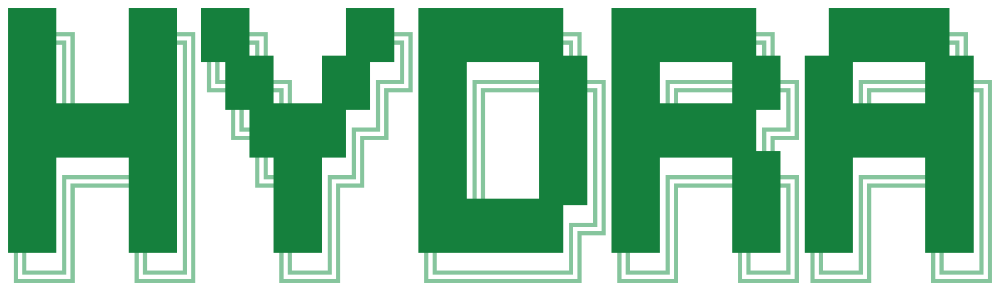
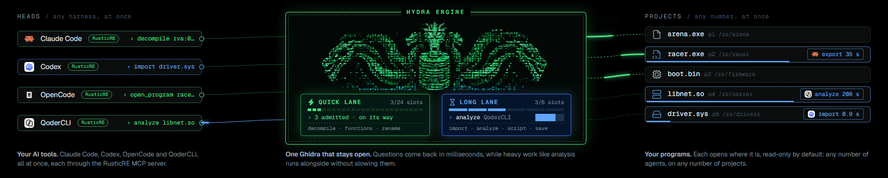

<p align="center">
  <picture>
    <source media="(prefers-color-scheme: dark)" srcset=".github/assets/logo-dark.svg">
    
  </picture>
</p>

<h1 align="center">Hydra Engine</h1>

<p align="center"><b>One Ghidra, many heads: a headless reverse-engineering engine for AI agents and tools.</b><br>
Many agents work in it at the same time, on any number of projects. A warm decompile takes
milliseconds to tens of milliseconds, by function size, not seconds.</p>

<p align="center"><sub>Hydra Engine is a fork of NSA's Ghidra (12.3 DEV, Apache-2.0) and depends on it: the project format, decompiler, analyzers and scripts are Ghidra's own. It is not affiliated with or endorsed by the National Security Agency or the Ghidra project, and it is not affiliated with Marvel. The Ghidra name belongs to its authors.</sub></p>

<p align="center">
  <a href="#quick-start"></a>
  <a href="https://www.hydrare.dev"></a>
  <a href="#works-best-with-hydralysis"></a>
</p>

<p align="center">
  <a href="LICENSE"></a>
  <a href="https://github.com/RusticStack/hydra-engine/actions/workflows/ci.yml"></a>
  
  
  
  
</p>

<p align="center">
  
</p>

<p align="center"><i>Every head at work at once. One body holds them all.</i><br>
<sub>Here Claude Code, Codex, OpenCode and QoderCLI all reach the engine through the
<a href="https://github.com/RusticStack/Hydralysis">Hydralysis</a> MCP server; any client can also connect directly.</sub></p>

In the myth, the Hydra has one body and many heads. Here the body is one long-lived JVM holding
Ghidra, its open projects, its analysed programs and its warm decompilers. The heads are the
clients: agent harnesses, MCP servers, scripts. They all work at the same time. They read the
same programs in parallel, each with its own pooled decompiler; they write through working
copies, private overlays or shared writing with an author journal (writes are serialized and never
corrupt a program; [what that does not promise](#platform-and-limits) is spelled out below); and one
head's import or whole-program analysis runs in the long lane while the others' native
millisecond commands (decompile, functions, list) keep flowing in the quick lane. A `script`
runs in the long lane, so a query sent as a script can queue behind long work
([measured, and what is planned](#platform-and-limits)). Heads come and go; the body stays. If a
client disconnects, its unsaved edits are dropped and its locks are released when its running
request ends; the others carry on.

**Hydra Engine is the project name; inside, it's Ghidra:** the same packages, modules, Gradle
projects and paths (`ghidra.*`, `Ghidra/Features/...`, `ghidra_12.3_DEV`), so Ghidra scripts and
extensions work unchanged. It is a fork of Ghidra 12.3 DEV: upstream `master` plus one module,
`Ghidra/Features/HeadlessSession`, a headless-only build and three small fixes to Ghidra classes,
tracking upstream by merge. The project format, the decompiler, the analyzers, the loaders and the
scripting API are Ghidra's, and the answers come from them. [NOTICE-HYDRA](NOTICE-HYDRA) lists
every upstream file changed.

## What it does

- **Many agents at the same time.** Claude Code, Codex, OpenCode, QoderCLI, MCP servers such as
  [Hydralysis](https://github.com/RusticStack/Hydralysis) and your own scripts all work in one daemon at
  once: one JVM per user. The first client starts it; the rest find it through a per-user endpoint
  file and join in milliseconds.
- **Many projects and programs at once.** Open any number of projects in place, by their `.gpr`
  or folder, and switch between programs without importing them again.
- **Read-only without a lock.** A project opens the way *File > View Project* does: no lock file,
  nothing written, so several clients, and a Ghidra window, can read it at the same time. Ask for
  `writable` when you want to change it.
- **Fair under load.** Quick requests (decompile, functions, list) and long ones (analyze,
  import, script) run in separate lanes, admitted round-robin by client, so one agent's
  whole-program analysis never stalls another's 10 ms query. Per-client (and per-label) cancel,
  and `busy`, `conflict` and `not_owner` answers that name who holds what and suggest what to
  do instead of a silent wait.
- **Several agents writing at once.** Each in the way its work needs:
  - a **working copy** of a project (`fork_project`) while the others keep reading the master:
    a block clone on ReFS (about 0.2 s and a few MB for a 1.5 GB project), a full copy
    elsewhere, with its source and base revision recorded;
  - a private **overlay** of a program others read: names, labels, comments, signatures and
    data types only that client sees, never saved unless promoted into a working copy;
  - **several writers** of one project (different programs in parallel), or of one program in
    shared mode, with every change journalled with its author, an optional `expect` per call
    against lost updates (without it, the last writer wins per value), atomic multi-operation
    `edit`s and `discard_edits`.
- **Fresh views.** Every project and program has a revision; when another process saves a
  project that a read-only view serves, its clients are told (`stale`), and `refresh` reopens it
  for all of them at once.
- **Imports once, in parallel.** Any format a Ghidra loader accepts; a file whose SHA-256 is
  already in the project is never imported twice. Up to `maxImports` imports run at once (four
  large PEs in 64 s instead of 165 s); the rest wait in a queue that `status` shows, with
  positions and estimated waits, and that `cancel` empties.
- **A versioned contract.** `hello` and `status` carry the protocol, the minimum client, the
  engine and Ghidra versions and an install id; each release ships the Python client as its own
  versioned zip, which refuses an engine it cannot drive.
- **Scripts, contained.** Any GhidraScript, Java or Python, with arguments. On a program you do
  not own, it runs inside a transaction that is always rolled back, so it cannot change what
  others see.
- **Fast start.** A standard-library Python launcher builds the classpath itself (no `.bat`, no
  `.sh`, no three extra JVMs), caches Ghidra's class search, and on JDK 25 uses an AOT cache.
  What no query needs (the language service, TLS, the script compiler) starts after `ready`.
- **Older projects, without the wait.** A program saved by an older Ghidra opens at once: the
  first open upgrades it in memory and answers, while an upgraded copy is built in the background
  (in the long lane, only when no client is waiting). Later opens are served from that copy. The
  project itself is never touched.

## Measured

Ghidra master (12.3 DEV) with this module, Windows 11, JDK 25.0.4, 24 threads, 64 GB, a USB
NVMe Dev Drive; a 66.7 MB x64 executable with 243,855 functions, opened read-only; AOT and class
search caches on. Medians from the
[module README](Ghidra/Features/HeadlessSession/README.md#performance):

| | Hydra Engine |
|---|---|
| No daemon running: start it and connect | 533 ms |
| Daemon start until the first decompile answer | 1,637 ms |
| Warm `decompile` of the benchmark's function (its size was not recorded; see below) | 6.7-7.1 ms |
| Another harness joins a running daemon: connect + `hello`, join the project, `open_program` (already open), `decompile` | 14 ms, 0.9 ms, 0.9 ms, 7.4 ms (measured on 12.1.4) |

A warm decompile depends on the function's size. Measured by the owner on a KotOR executable
(2026-10-27): 0.7-2.1 ms for a one-byte function, 35-45 ms for a 6.7 KB function of 29 basic
blocks. So "about 7 ms" is one function in one program, not a constant.

The same question through stock `analyzeHeadless` (`-process ... -readOnly -postScript`, one
decompile) took 7.0-7.8 s per question, and needed a copy of the project (measured on 12.1.4).

Several at once (same machine; the module README has the method):

| | |
|---|---|
| Four large PEs imported in parallel (`maxImports` 4) | 63.9 s, against 165.1 s one after another |
| Decompiles while two 128 MB imports write into the same project | median 4.9 ms (5.7 ms before) |
| Working copy of a 1.5 GB project on ReFS (`fork_project`) | 204-225 ms, 2.8-5.0 MB |
| Four clients x two threads, shared writing on one program | 3,200 renames and comments with 64 saves in 6.0 s, none dropped, each value ending as its last writer left it |

## Platform and limits

- **Windows x64 only, for releases.** Each release has `hydra-engine-<version>-win_x86_64.zip`.
  CI and the tests run on Windows. Linux and macOS: from source only, and a one-off dry run
  passed on them; they are not tested routinely.
- **JDK 25 is required** (`application.java.min`), and Python 3.10 or later for the launcher.
- **One daemon per state directory**, which is per user unless you set `GHIDRA_SESSION_HOME`
  (or an instance name); a second daemon for the same one exits.
- **`fork_project` is a block clone only on ReFS** (Windows 11 24H2 or later, for example a Dev
  Drive); on NTFS and elsewhere it is a full copy, which `auto` refuses above `forkCopyLimitMb`.
- **Writes are serialized and never corrupt a program, but they are not collision-checked by
  default.** Each change is its own transaction under the program's exclusive lock. In shared
  mode (`"share": true`) the last writer wins per value; optimistic concurrency is opt-in per call
  (`expect`, in the module README's "Shared writing"). In owner mode one client writes and the
  rest get `not_owner`.
- **The quick lane protects native commands, not scripts.** `decompile`, `functions`, `list`,
  `open_program` and the like take a quick slot; `analyze`, `import`, `script`, `save` and
  `fork_project` take a long slot (a quarter of the CPUs, at least two). A client that sends its
  reads as `script` requests, as Hydralysis does today, shares those slots with imports and
  analysis. Measured on 12.3-hydra.3 with two 8 s scripts holding a two-slot long lane: ten
  short scripts that asked for the quick lane all succeeded but took 8.05 to 8.27 s each, and
  `save` and `fork_project` answered `busy` after their 5 s wait. Admission by lane hint is
  planned (see `PROTOCOL-3.md`), not shipped.
- **A client that dies while waiting for a lock stays registered until the lock frees.** The
  engine cancels its request when the connection closes, but a lock wait does not end on cancel,
  and a script that does not poll for cancellation runs to its own end. Measured: a client killed
  while blocked in a 1-hour `wait` was still registered 40 s later and left 0.5 s after the
  holder was cancelled. Java cannot stop a non-cooperative thread; this is a documented limit, and
  a bounded release for lock waits is planned.
- **Changes are kept only by `save`.** Until a client saves, they live in the daemon's memory.
- **Projects upgrade one way.** Ghidra 12.1.4 projects open read-only, unchanged; writing one
  with this build (it asks for `"upgrade": true`) moves its databases to a format that Ghidra
  12.2 and 12.1.4 cannot read. Work on a `fork_project` copy when the original must stay as it is.

## Works best with Hydralysis

[Hydralysis](https://github.com/RusticStack/Hydralysis) is the reverse-engineering toolkit made for
Hydra Engine: twenty tools for programs you own, as one CLI and one MCP server. Register it in each
of your harnesses (Claude Code, Codex, OpenCode, QoderCLI or any MCP client) and they all get the
same tools on one warm engine. It prepares a binary once, as a durable job; answers bounded
decompiles and references in milliseconds; finds and checks hook sites by signature and prologue;
runs verified runtime sessions; and stores a finding only with its source. Its `backend install`
fetches the pinned Hydra Engine release and a JDK, so setting up Hydralysis sets up both.

Hydra Engine stays a generic Ghidra front end that any client can use directly; Hydralysis is the
quickest way to put it to work.

> **Status.** Hydralysis is the new name of RusticRE (v0.4.0, twenty tools), and the rename is
> in progress: the `RusticStack/Hydralysis` repository, the `hydralysis` command and
> `HYDRALYSIS_ROOT` are not published yet, so the links and commands below do not work until
> they are. Until then Hydra Engine works on its own, as described above and in the module
> README.

## Quick start

You need a JDK 25 and Python 3.10 or later.

**With your AI.** Once Hydralysis is published (see its status above), paste this into Claude
Code, Codex, OpenCode or Qoder. It installs
[Hydralysis](https://github.com/RusticStack/Hydralysis), which installs the pinned Hydra Engine
release and registers itself with your harness:

```text
Set up Hydralysis and Hydra Engine from github.com/RusticStack/Hydralysis. Ask me which AI harnesses to add it to if you can; otherwise, use this one.
```

**Download (Windows x64).** Each [release](https://github.com/RusticStack/hydra-engine/releases)
has `hydra-engine-<version>-win_x86_64.zip`, the client alone as `hydra-client-<version>.zip`,
and a `SHA256SUMS`. Unzip the engine anywhere; it holds the install, `ghidra_12.3_DEV\`:

```powershell
Get-FileHash hydra-engine-12.3-hydra.3-win_x86_64.zip     # compare with SHA256SUMS
Expand-Archive hydra-engine-12.3-hydra.3-win_x86_64.zip C:\tools
$G = "C:\tools\ghidra_12.3_DEV"
python $G\Ghidra\Features\HeadlessSession\support\ghidra_session.py ensure   # the daemon
& $G\support\analyzeHeadless.bat C:\re MyProject -import target.exe          # stock headless
```

**Or build** the headless install (Linux and macOS: from source only, for now):

```sh
git clone https://github.com/RusticStack/hydra-engine.git
cd hydra-engine
./gradlew -I gradle/support/fetchDependencies.gradle -DnoEclipse   # once
./gradlew buildHeadless                                             # -> build/dist/ghidra_12.3_DEV
```

(On Windows, `gradlew.bat`. The full Ghidra build with the GUI is still there:
`gradle buildGhidra`. Details in [CONTRIBUTING](.github/CONTRIBUTING.md#build).)

Start the daemon and look at it:

```sh
GS=build/dist/ghidra_12.3_DEV/Ghidra/Features/HeadlessSession/support/ghidra_session.py
python $GS ensure                                   # starts the daemon if it is not running
python $GS status                                   # projects, programs, clients, lanes, memory
```

Each `python $GS call <cmd> ...` is one request from a new client that disconnects when it
returns, so nothing it opened carries over to the next `call`: `call open_project` followed by
`call decompile` answers `no_project`. Use `call` for a request that needs nothing opened
first (`call ping`), and one connection for a sequence, as below.

<p align="center">
  <picture>
    <source media="(prefers-color-scheme: dark)" srcset=".github/assets/session-dark.svg">
    
  </picture>
</p>

<p align="center"><sub>A real session against a small test program (a 140 KB x64 executable built from 20 lines of C, with its PDB), replayed. The timings are the wall times the Python side measured; the second decompile is warm.</sub></p>

## Connect from a harness

From Python, copy `ghidra_session.py` next to your code or put its folder on `sys.path`:

```python
import ghidra_session as gs

with gs.connect(client="my-tool", harness="claude-code") as s:   # joins the daemon, or starts it
    s.call("open_project", path="/re/MyProject")                   # read-only, no lock
    s.call("open_program", path="target.exe")
    print(s.call("decompile", name="main")["c"])
    for f in s.call("functions", contains="crypt")["functions"]:
        print(f["name"], f["address"])
```

- **Name yourself.** `client` is your tool, `harness` is the agent harness running it; `status`
  shows both, and `busy` errors name them.
- **One connection per process.** It is thread-safe. If one connection carries several
  independent callers, as an MCP server's does, send `parallel=True` on each request.
- **Other languages** speak the same protocol: run `python ghidra_session.py ensure` once, read
  `default.json` in the state directory (`%LOCALAPPDATA%\GhidraSession`,
  `~/Library/Application Support/GhidraSession` or `~/.local/state/ghidra-session`), connect to
  its loopback port, and send JSON lines, the first being `hello` with the token.
- **MCP servers** wrap the client: one daemon connection for the server, one tool per command
  they expose, and a per-request `client`/`harness` label for each agent they serve. The session
  is a generic Ghidra front end; the tools belong to the client.

**Through Hydralysis** (not published yet; renamed from RusticRE). By hand, from a checkout of
[Hydralysis](https://github.com/RusticStack/Hydralysis) (Python 3.11 or later), with
`HYDRALYSIS_ROOT` set to a directory for its engine, prepared projects, evidence and logs:

```bash
uv venv .venv
.venv/Scripts/python.exe -m pip install -e .
.venv/Scripts/hydralysis.exe backend install    # the pinned Hydra Engine release and a JDK, as a job
```

Then register it in any harness that reads the common `mcpServers` shape, and restart the harness:

```json
{
  "mcpServers": {
    "hydralysis": {
      "command": "/path/to/Hydralysis/.venv/Scripts/hydralysis.exe",
      "args": ["mcp"],
      "env": { "HYDRALYSIS_ROOT": "/path/to/hydralysis-data" }
    }
  }
}
```

The [Hydralysis docs](https://www.hydrare.dev/docs/mcp-server) cover the tools and the workflow.

The protocol, every command and every error code are in the
[module README](Ghidra/Features/HeadlessSession/README.md#protocol-version-2); task-by-task guides
are in the [docs](https://www.hydrare.dev/docs/quick-start).

## Compared with stock headless Ghidra

| | `analyzeHeadless` | Hydra Engine |
|---|---|---|
| Lifetime | one run per command, then exit | one daemon per user, stays up (or idles out) |
| Clients | the one that started it | any number, at once |
| Projects | one per run | any number, at once |
| Project lock | always, even with `-readOnly` | none for a read-only view; one per daemon when writable, shared by its clients |
| Several writers | one process per project | several clients per project or per program, overlays, working copies; one change at a time, last writer wins unless `expect` is sent |
| Programs | the ones `-import`/`-process` select | open, switch, close at will, without importing |
| A question about an analysed program | 7.0-7.8 s (start, open, decompile, exit) | about 1-45 ms warm, by function size ("Measured") |
| Re-import of the same file | a second copy | refused by SHA-256 |
| Scripts | pre/post scripts per run | any time, contained or as owner, with arguments |
| Launcher | `.bat` / `.sh` + `LaunchSupport` | one Python file, standard library only |
| A client crashes | the run dies | its locks are released when its running request ends, the rest carry on |

`analyzeHeadless` is still in the install and still the right tool for a one-shot batch
import.

## Configuration

Defaults work. Lowest to highest: defaults, `<state>/config.json`, environment, command-line
options. The ones you are most likely to touch:

| `config.json` | Environment | Default | |
|---|---|---|---|
| `java` | `GHIDRA_SESSION_JAVA_HOME` | discovered | The JDK. |
| `maxHeap` | `GHIDRA_SESSION_MAXMEM` | a quarter of RAM, 2-31 GiB | `-Xmx`. |
| `tmpdir` | `GHIDRA_SESSION_TMPDIR` | the JVM's | Where Ghidra keeps unsaved database buffers. |
| `idleTimeout` | `GHIDRA_SESSION_IDLE_TIMEOUT` | `0` (stay up) | Seconds without clients before the daemon exits. |
| `keepWarm` | `GHIDRA_SESSION_KEEP_WARM` | `3600` | Seconds an unused read-only program stays open for the next client. |
| `aot` | `GHIDRA_SESSION_AOT` | `auto` | Use the AOT cache when one exists (`ghidra_session.py aot` builds it, JDK 25+). |

The state directory is `GHIDRA_SESSION_HOME` or the per-user default above. `ghidra_session.py
config` prints the effective configuration; the full table is in the
[module README](Ghidra/Features/HeadlessSession/README.md#configuration).

**Security.** The daemon binds loopback only and every connection must present the 256-bit
token from the owner-only endpoint file. Anyone who can read your state directory can drive the
daemon with your rights, and a script runs with the daemon's rights: containment protects other
clients' view of a program, not the machine. See [SECURITY](.github/SECURITY.md).

## Building

| | Command | What you get |
|---|---|---|
| Headless (default) | `gradle buildHeadless` | an unzipped install in `build/dist/`, or `-PheadlessInstallDir=<dir>`; `zipHeadless` zips it |
| Full Ghidra, with the GUI | `gradle buildGhidra` | Ghidra's usual zip in `build/dist/` |

The headless install leaves out the window-only modules, the help, javadoc and Python stubs, the
user docs and `ghidraRun`, and keeps everything headless analysis uses: every processor, the
loaders and analyzers, the decompiler, scripting, the Ghidra server and the session module.


| Windows x64, same commit | `buildHeadless` | `buildGhidra` |
|---|---|---|
| Gradle tasks that run (clean build) | 524 | 836 |
| Install | 2,790 files, 639 MB (a directory) | 5,332 files, 862 MB (538 MB zip) |
| Module jars / jars on the launcher's classpath | 178 / 139 | 197 / 158 |
| Cold build, no build cache ([noisy, see CONTRIBUTING](.github/CONTRIBUTING.md#build-times)) | 6-16 min | 32-36 min |

Both installs give the same answers: imported and analysed in each, three test binaries (a small
x64 program with its PDB, a Windows EXE and a DLL) had the same function counts and names and
byte-identical decompiled C for all 675 functions decompiled, and the daemon started, opened a
program and answered its first decompile in the same time (medians of 5, within 3%).

Nothing is removed from the source tree. How the module list was worked out, and the check that
keeps it honest, are in [CONTRIBUTING](.github/CONTRIBUTING.md#the-headless-build).

CI ([`ci.yml`](.github/workflows/ci.yml)) builds the headless install and runs
`session_smoke.py`, `daemon_tests.py` and `contract_tests.py` on Windows, the platform that is
tested and released. The launcher and module have no Windows-only path, and Linux x64 and macOS
arm64 builds passed the suites of the time once (a release dry run, 2026-10-26), but neither is
tested routinely. The full build
runs weekly. Releases are cut by [`release.yml`](.github/workflows/release.yml)
([CONTRIBUTING](.github/CONTRIBUTING.md#releases)).

For Ghidra's own GUI build and usage docs, see Ghidra's original README:
[README-GHIDRA.md](README-GHIDRA.md).

## Upstream sync

`main` is upstream Ghidra `master` plus the additions above, merged (never rebased) when
upstream moves. Few upstream files are changed: `README.md`, one line of `build.gradle`, two
lines of `gradle/distributableGhidraModule.gradle`, `.gitattributes`, the issue templates (replaced
by issue forms), and
three small Java fixes (`LocalBufferFile`, `LocalDatabaseItem`, `SleighLanguageFile`; see the
module README's "Changes outside this module"), so a sync conflicts in those at most. All of
them are listed in [NOTICE-HYDRA](NOTICE-HYDRA), which every release ships. The steps
and the resolutions are in [CONTRIBUTING](.github/CONTRIBUTING.md#upstream-sync).

Branches: `main` (on upstream `master`) and `legacy-12.1.4`, the same module on Ghidra 12.1.4,
kept only for projects analysed with 12.1.4. A project opened writable by `main` may be upgraded
to a database version that 12.1.4 cannot read; open older projects from a copy.

## Built with Hydra Engine

Games remade in new engines, drivers brought back, tools rebuilt: projects made by
reverse-engineering programs their authors own are on the [showcase](https://www.hydrare.dev/examples),
which reads the [RusticStack/hydra-re-showcase](https://github.com/RusticStack/hydra-re-showcase) repository. Add yours
there, by pull request or with its [form](https://github.com/RusticStack/hydra-re-showcase/issues/new?template=project.yml).

## License and credits

[Apache License 2.0](LICENSE), the license of Ghidra. Ghidra's [NOTICE](NOTICE) and the
third-party licenses in [`licenses/`](licenses) and [`GPL/`](GPL) apply unchanged; what Hydra
Engine adds or modifies, and the disclaimers, are in [NOTICE-HYDRA](NOTICE-HYDRA). Changes are in
[CHANGELOG.md](CHANGELOG.md).

Ghidra is the work of the National Security Agency's Research Directorate and the Ghidra
contributors. Hydra Engine would be nothing without it.

The Hydra is the many-headed serpent of Greek myth, which grew two heads for every one cut off.
Any resemblance to a certain comic-book organisation is limited to the name: we keep no secret
base, only a daemon, and the serpent here is our own drawing.
